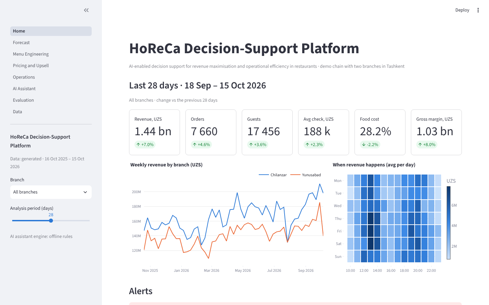
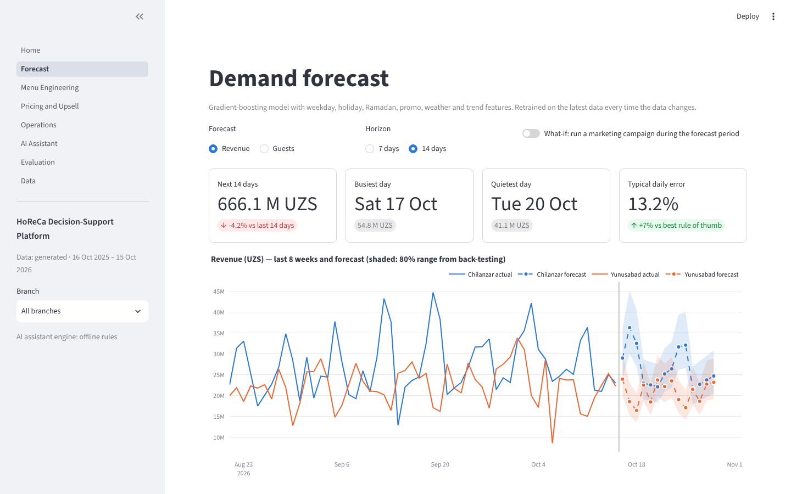
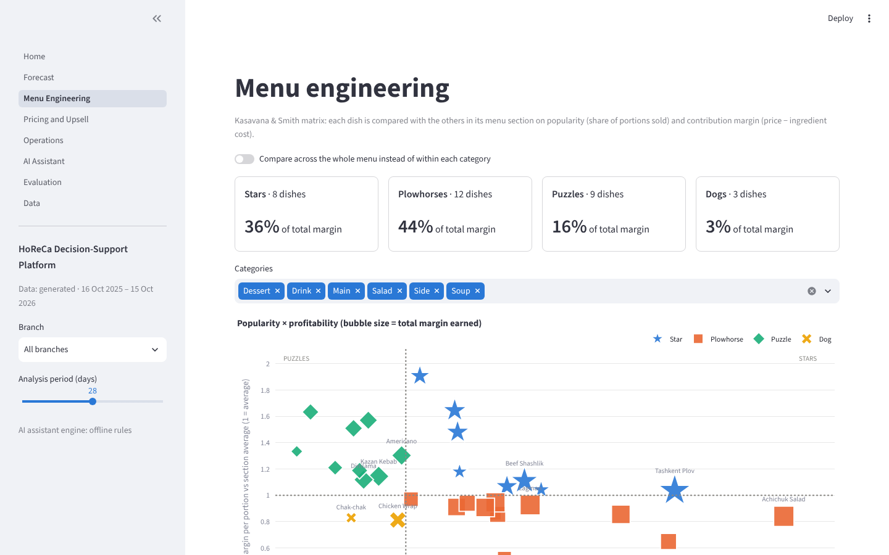
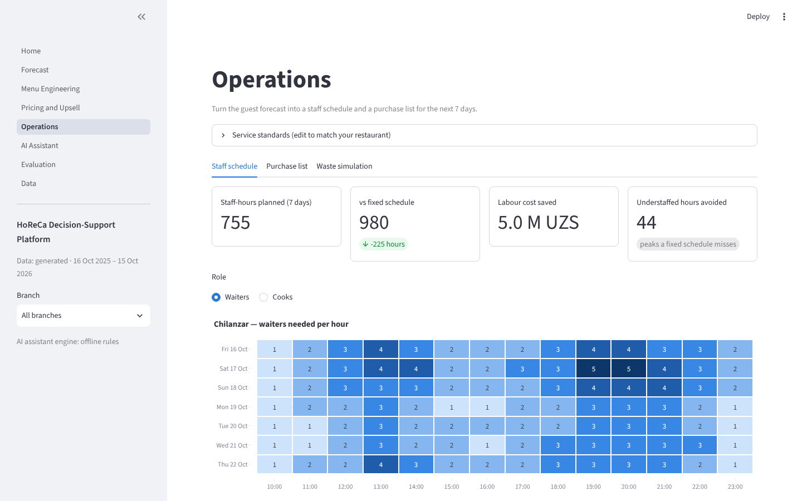
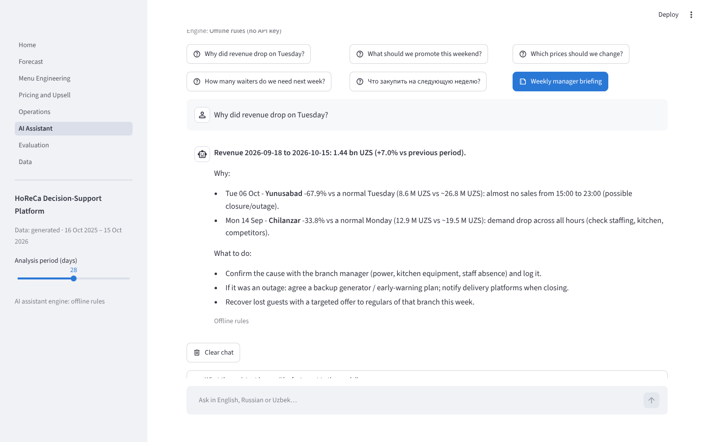
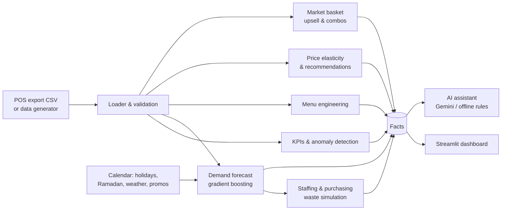

# HoReCa Decision-Support Platform

**An AI-enabled decision-support platform for revenue maximisation and operational efficiency in the HoReCa sector.**

This is the practical prototype for my Master's thesis (ITPU × EPAM, MS in IT Project Management & AI, 2025–2026).
It is for a restaurant manager. You load point-of-sale (POS) data and the platform answers four questions:

| Question | Module | Method |
|---|---|---|
| *How busy will we be?* | **Demand forecast** | Gradient boosting with calendar, holiday, Ramadan, promo and weather features, checked against manager rules of thumb |
| *What should we sell, and at what price?* | **Menu engineering, pricing, upsell** | Kasavana–Smith matrix, log-log price elasticity, market-basket rules |
| *How many staff and how much stock do we need?* | **Operations** | Forecast → hourly guests → staff schedule; forecast × recipes → purchase list; waste simulation |
| *What does it mean, and what do I do?* | **AI assistant** | Gemini explains the computed facts in English, Russian or Uzbek, with an offline fallback |



### Changes after the PM mentor review (21 Oct 2026)

The review asked for real-world validation. Each growth point now has a concrete answer:

| Growth point | What was added |
|---|---|
| Pilot with real restaurant data | [Validation plan](docs/validation_plan.md): a 6-week A/B pilot with KPIs, success targets and a go / no-go gate |
| Structured feedback from branch and operations managers | **"Was this useful?" 👍 / 👎 + comment** on every recommendation and AI answer, saved with the user's role; summary on the Evaluation page |
| Scale to more restaurants and bigger data | [Scale test](docs/scale_test.md): 2 → 10 branches (0.5 → 2.9 million order lines). 5.4× more data took 3.8× more time, and the forecast stays accurate |

The AI assistant now also shows **how long each answer took**. Gemini 2.5 Flash runs with "thinking" switched off, because it only explains numbers that are already computed. This makes answers faster and cheaper.

---

## Quick start

**Windows:** double-click `run.bat`. It creates a virtual environment, installs the packages and opens the app in your browser.

**macOS / Linux:**

```bash
./run.sh
```

**Manual:**

```bash
python -m venv .venv
.venv\Scripts\activate          # Windows   (macOS/Linux: source .venv/bin/activate)
pip install -r requirements.txt
streamlit run app/Home.py
```

Requires Python 3.10+. On the first start the app generates one year of demo data (takes about 2 seconds), so nothing else needs to be downloaded.

### Turn on the AI assistant (free)

1. Create a free API key at [Google AI Studio](https://aistudio.google.com/app/apikey).
2. Copy `.env.example` to `.env` and paste the key: `GEMINI_API_KEY=your-key`.
3. Restart the app.

Without a key, or when the free quota runs out, the assistant answers with built-in rules computed from the same numbers, so a demo never breaks. The `.env` file is in `.gitignore`, so your key is never committed.

---

## What is inside

| Page | What the manager gets |
|---|---|
| **Overview** | Revenue, orders, guests, average check, food cost and gross margin vs the previous period; weekly trend; hour × weekday heat-map; **alerts** for unusual days with a likely cause (holiday, promo, weather, "no sales from 15:00 → possible outage"); this week's top recommendations |
| **Forecast** | 7–14-day revenue / guest forecast per branch with an 80% range, a what-if for marketing campaigns, guests per hour, and an accuracy back-test vs two rules of thumb |
| **Menu engineering** | Stars / Plowhorses / Puzzles / Dogs within each menu section, with a concrete action per dish |
| **Pricing & upsell** | Price elasticity per dish (with confidence), margin-maximising price changes or proposed price tests, waiter upsell scripts valued in UZS, combo ideas |
| **Operations** | Waiters and cooks needed per hour, shift blocks, savings vs a fixed schedule, ingredient purchase list, perishable-waste simulation |
| **AI assistant** | Chat and a one-click weekly manager briefing; shows exactly which facts were sent to the model |
| **Evaluation** | All accuracy and impact numbers in one place (for the report), plus a check that the methods recover the ground truth planted in the generated data |
| **Data** | Switch to your own POS export (CSV), download a template, preview the data |

## Screenshots

| Forecast | Menu engineering |
|---|---|
|  |  |
| **Operations** | **AI assistant** |
|  |  |

## Architecture



All numbers are computed by the analytics modules. The language model only explains them, which keeps answers grounded and keeps the token cost small (about 1.5k tokens of context). See [docs/architecture.md](docs/architecture.md) for details.

## Evaluation (demo data: seed 42, one year up to 15 Oct 2026)

Reproduce with `python scripts/evaluate.py --end 2026-10-15` (writes `docs/results.md`). The app's demo data also ends on 15 Oct 2026, so the app shows the same numbers. You can switch to a rolling window (data up to yesterday) on the **Data** page, or with `HORECA_DATA_END=yesterday`.

| Measure | Result |
|---|---|
| Revenue forecast error (WAPE), 8 rolling origins × 14 days | **13.2%** vs 14.2% (avg of last 4 same weekdays) and 16.2% (same weekday last week) |
| … on holidays, promo days and Ramadan | **10.6%** vs 17.0% / 16.2% |
| Perishable waste, forecast-based vs "last week + 15%" ordering (4-week simulation) | **−35%** waste, fewer shortages (3.9% vs 5.0% of use) |
| Staff-hours vs a fixed schedule (next 7 days) | **−225 hours** and 44 understaffed peak hours avoided |
| Planted item pairings recovered by basket analysis | 10 of 12 |
| Planted incidents (outage, equipment failure) detected | 2 of 2 |
| Scale: 10 branches, 2.9 M order lines (one year) | full analysis in **45 s** (2 branches: 12 s); forecast WAPE 10.6% vs 13.2% for the best rule |

These are results on **synthetic data**. They show that the methods work and how big the effects could be. Real impact has to be confirmed with a pilot (A/B test between the two branches).

## Using your own data

Upload a CSV on the **Data** page. One row per item in an order:

| column | required | example |
|---|---|---|
| `order_id` | yes | `CH0001234` |
| `datetime` | yes | `2026-10-06 14:35` |
| `branch` | yes | `Chilanzar` |
| `item_name` | yes | `Tashkent Plov` |
| `qty` | yes | `2` |
| `unit_price` | yes | `49000` |
| `item_id`, `category`, `covers` (guests), `channel`, `unit_cost` | optional | filled with defaults when missing |

## Project structure

```
app/                    Streamlit UI (Home.py = Overview, pages/ = other pages, ui.py = shared helpers)
src/horeca_dss/
  data/                 generator (synthetic POS data), calendar (UZ holidays, Ramadan, climate), loader
  kpis.py               KPIs, period comparison, anomaly detection
  forecasting.py        demand model, rolling-origin back-test, hourly / item disaggregation
  menu_engineering.py   Kasavana-Smith classification
  pricing.py            elasticity estimation, price recommendations
  basket.py             association rules, upsell value, combos
  operations.py         staffing, purchasing, waste simulation
  assistant.py          facts -> context, Gemini client, offline answers
  feedback.py           manager feedback log (👍 / 👎 + comments) and usefulness summary
  analysis.py           runs everything with one set of settings
scripts/evaluate.py     reproduces the evaluation numbers
scripts/scale_test.py   times the full analysis for 2, 5 and 10 branches
tests/                  pytest suite (25 tests)
docs/                   architecture, demo script, backlog, results, validation plan, scale test
```

Run the tests with `pip install -r requirements-dev.txt` and then `pytest -q`.

## Limitations and next steps

- The demo data is synthetic. Next step: a pilot on a real restaurant's POS export (iiko / R-Keeper / Poster).
- Price elasticities need price variation. Dishes without it get a *price test* instead of a price change.
- Weather for future days uses climate averages. A weather API would improve hot/cold-day forecasts.
- Planned: a Telegram bot for the daily briefing, a hotel (rooms + F&B) module, and automatic POS integration.

## Author

**Rasulbek Shaxnazarov**, MS in IT Project Management & AI, IT Park University (ITPU) × EPAM.
Scientific advisor: Serhii Bulba · Technical mentor: Raman Loseu.

Licensed under the MIT License.
