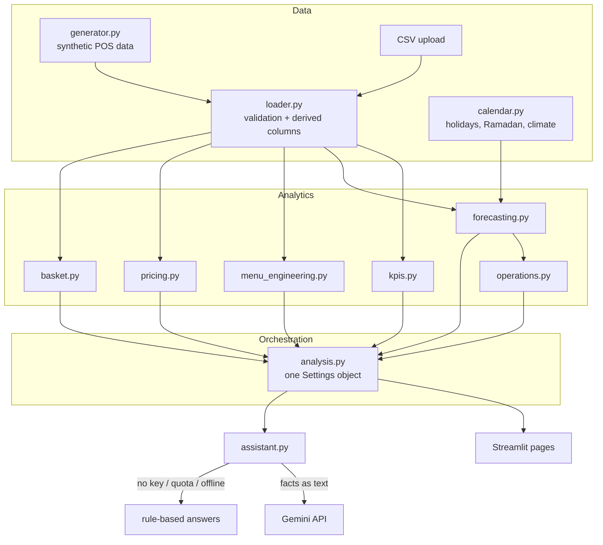

# Architecture and design decisions

## Layers

## Main decisions

| Decision | Why |
|---|---|
| **Streamlit** user interface | A working web app in days, not weeks; managers open it in a browser; easy to demo live |
| **Synthetic data with planted structure** | No real POS data was available during the internship. Planting known effects (price sensitivity, pairings, incidents) makes it possible to *verify* that each method finds them |
| **Global gradient-boosting model, target relative to the recent level** | Tree models can't extrapolate trends; predicting the ratio to the 28-day level fixes this. One model shared by the branches learns from more data |
| **Rolling-origin back-test against managers' rules of thumb** | The fair question is "is it better than what the manager does today?", not an abstract metric |
| **Relative price (dish ÷ average of its section) for elasticity** | Menu-wide price updates (inflation) do not bias the estimate; guests mostly switch between dishes of the same section |
| **No price change without enough evidence** | Dishes with little price history get a 2-week test proposal instead, so the platform does not over-claim |
| **The LLM explains, it does not calculate** | All numbers come from deterministic code. The model gets a ~1.5k-token fact sheet. That keeps answers grounded, cheap (free tier) and auditable ("What the assistant knows" panel) |
| **Offline fallback for the assistant** | A demo or a manager's morning must not depend on an API quota |
| **Caching keyed by dataset id** | Each heavy step (model training, back-tests) runs once per dataset and settings |

## Data model (order lines)

`order_id, datetime, branch, channel, covers, item_id, item_name, category, qty, unit_price, unit_cost`
→ derived: `date, hour, revenue = qty × unit_price, food_cost = qty × unit_cost`

Reference tables: `menu` (current price and cost), `recipes` (item → ingredient quantity per portion),
`ingredients` (unit, cost, shelf life), `calendar` (holiday, Ramadan, promo, temperature).

## Methods in short

- **Anomalies:** revenue compared with the median of the same weekday over the previous 4 weeks. A ±30% deviation is flagged and explained from the calendar, or from hours with almost no sales (outage).
- **Forecast:** features = branch, weekday, month, seasonality (sin/cos), holiday type, promo, Ramadan, temperature, lags 7/14/21/28, average of the last 4 same weekdays, level. Recursive multi-step. 80% range from back-test residuals.
- **Hourly and item level:** the daily guest forecast is split with the last 8 weeks' hour profile per branch and weekday, and turned into portions with the last 4 weeks' portions per guest.
- **Menu engineering:** popularity threshold = 70% of an equal share; margin threshold = the section's quantity-weighted average contribution margin.
- **Pricing:** OLS `log(q/guests) ~ log(relative price) + weekday + temperature + branch + trend`. Candidate moves of ±5% and ±10% are scored with a constant-elasticity demand curve. The objective is contribution margin, with a volume drop of at most 8%.
- **Basket:** pair rules (support, confidence, lift) from a sparse order × item matrix. Upsell value = orders with A but without B × acceptance rate × margin of B.
- **Staffing:** headcount per hour = ceil(guests ÷ guests-per-staff-hour), at least 1. Compared with a fixed headcount sized at the 85th percentile of hours.
- **Waste:** daily ordering of perishables (shelf life ≤ 3 days) simulated for 4 weeks. Unused stock is counted as waste, missing stock as shortage.
